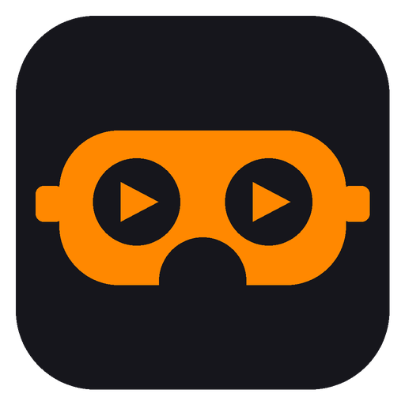

# VR Player

A lightweight Windows player for **VR180 and 360° videos** that you watch on a normal screen. Drag with the mouse to look around, like the players on video sites, with VLC-style controls.



## Features

- **Formats:** 180° side-by-side (the usual VR180 layout), 360° side-by-side, 180°/360° top-bottom and 360° mono.
- **Looking around:** drag to look, Ctrl+scroll to zoom, and **Center** resets the view.
- **VLC-style controls:**
  - Scroll over the video or the volume bar to change the volume, **up to 200%**.
  - Scroll over the timeline to seek 5 seconds per notch, or 30 seconds with Shift.
  - Hover over the timeline to preview the time at that point.
  - Keys: Space to pause, ←/→ to skip 10 seconds, ↑/↓ for volume, M to mute, F/F11 or a double-click for fullscreen, and Ctrl+O to open a file.
- **Remembers your settings:** your volume and format choice, plus where you stopped in each video.
- **Open with:** right-click a video, choose **Open with → VR Player**, or drag files onto the window.
- **Private:** runs entirely offline, sends no data anywhere and has no telemetry.

## Download

Grab `VR-Player-Setup-x.y.z.exe` (installer) or `VR-Player-x.y.z-portable.exe` (no install needed) from the [Releases](../../releases) page.

> Windows SmartScreen may say "Windows protected your PC" because the app isn't code-signed yet. Click **More info → Run anyway**.

## Building from source

Requires Node.js 20 or later.

```bash
npm install
npm start        # run in development
npm run dist     # build installer + portable exe into dist/
```

Pushing a tag such as `v1.0.1` triggers the GitHub Actions workflow, which builds the installers and attaches them to a GitHub Release.

## License

MIT. Bundles [three.js](https://threejs.org) (MIT).
